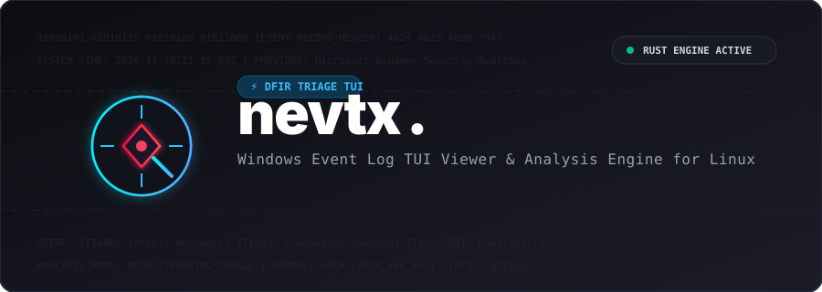

<div align="center">

  

  # `nevtx` 🔍
  **The modern, lightweight Windows Event Log (`.evtx`) TUI viewer and DFIR triage tool for Linux.**

  ```text
  ███╗   ██╗███████╗██╗   ██╗████████╗██╗  ██╗
  ████╗  ██║██╔════╝██║   ██║╚══██╔══╝╚██╗██╔╝
  ██╔██╗ ██║█████╗  ██║   ██║   ██║    ╚███╔╝ 
  ██║╚██╗██║██╔══╝  ╚██╗ ██╔╝   ██║    ██╔██╗ 
  ██║ ╚████║███████╗ ╚████╔╝    ██║   ██╔╝ ██╗
  ╚═╝  ╚═══╝╚══════╝  ╚═══╝     ╚═╝   ╚═╝  ╚═╝
  ```

  <p>
    <a href="LICENSE"></a>
    <a href="https://www.python.org/"></a>
    
    <a href="https://textual.textualize.io/"></a>
  </p>

  <p>
    <a href="#-killer-features">Features</a> •
    <a href="#-quick-start">Quick Start</a> •
    <a href="#%EF%B8%8F-keybindings--controls">Keybindings</a> •
    <a href="#-architecture--dfir-capabilities">DFIR Capabilities</a> •
    <a href="#%EF%B8%8F-roadmap">Roadmap</a>
  </p>

</div>

---

Designed specifically for **DFIR (Digital Forensics & Incident Response)** analysts, SOC investigators, and security researchers who daily-drive Linux and need a fast, keyboard-centric way to inspect Windows Event Logs without Wine, heavy Windows VMs, or sluggish web engines.

---

## ⚡ Killer Features

* **⚡ Blazing Fast Rust Engine:** Powered by high-performance Rust `.evtx` bindings with minimal memory footprint (~40MB RAM).
* **🎯 Automated MITRE ATT&CK Triage:** Instant signature matching for ransomware behavior (`T1490`), credential dumping (`T1003`), obfuscated PowerShell (`T1059.001`), and log tampering (`T1070.001`).
* **🛡️ Visual Threat Ratio Bar:** Real-time visual ratio bar (`% Threats vs Clean Events`) giving immediate visibility into incident severity.
* **🚨 Anti-Forensics Log Gap Detector:** Automatically identifies suspicious gaps of silence in event streams where an attacker stopped logging services or cleared traces.
* **🔓 On-The-Fly Base64 Decoder:** Automatically extracts, decodes, and renders obfuscated PowerShell payloads in cleartext.
* **📁 Multi-File Folder & Unified Timeline:** Open an entire directory (`nevtx ./logs/`) and switch between files or correlate events across a **Unified Merged Timeline**.
* **⌨️ Keyboard-Centric & Vim-Friendly:** Navigate with `j`/`k`, search with `/`, and filter threat categories using quick keys `1`-`6`.
* **🎮 Instant Demo Mode:** No `.evtx` files handy? Run `nevtx --demo` to test with simulated real-world attack scenarios instantly.

---

## 🚀 Quick Start

### Installation

```bash
# 1. Clone the repository
git clone https://github.com/boryokusha/nevtx.git
cd nevtx

# 2. Create virtual environment and activate
python3 -m venv .venv
source .venv/bin/activate       # For Bash / Zsh
# or: source .venv/bin/activate.fish   # For Fish shell (Arch / CachyOS)

# 3. Install in editable mode
pip install -e .
```

### Usage

```bash
# 1. Inspect a single .evtx file
nevtx /path/to/Security.evtx

# 2. Inspect an entire folder of logs with unified timeline & file switcher
nevtx ~/Documents/evtx_files/

# 3. Test immediately with built-in realistic DFIR attack scenario (Zero files needed!)
nevtx --demo
```

---

## ⌨️ Keybindings & Controls

| Key | Action |
| :---: | :--- |
| `↑` / `↓` or `k` / `j` | Navigate through event rows |
| `/` | Focus instant search bar (regex, event id, command, username) |
| `Esc` | Unfocus search and return to event table |
| `1` | Show **All** Events |
| `2` | 🚨 Show **Threats / MITRE Matches Only** |
| `3` | 🔑 Show **Failed Logons (4625)** |
| `4` | 💻 Show **Process Creation (4688)** |
| `5` | ⚡ Show **PowerShell Execution (4104)** |
| `6` | 🧹 Show **Audit Log Cleared (1102 / 104)** |
| `q` | Exit application |

---

## 🔍 Architecture & DFIR Capabilities

```text
┌─────────────────────────────────────────────────────────────┐
│ nevtx Engine                                                │
│                                                             │
│  [Windows .evtx Files] ──> [Rust-backed Fast Parser]        │
│                                   │                         │
│                                   ▼                         │
│                    [Normalized Event Models]                │
│                                   │                         │
│         ┌─────────────────────────┴─────────────────────┐   │
│         ▼                                               ▼   │
│  [MITRE ATT&CK Engine]                        [Log Gap Detector]
│  (T1490, T1003, T1059, etc.)                  (Anti-Forensics)
│         │                                               │   │
│         └─────────────────────────┬─────────────────────┘   │
│                                   ▼                         │
│                     [Modern Textual TUI Display]            │
│                     (Live Inspector + Search + Ratio Bar)   │
└─────────────────────────────────────────────────────────────┘
```

---

## 🗺️ Roadmap

- [x] **v0.1.0:** Core Rust engine, Textual TUI, MITRE ATT&CK engine, Base64 decoder, Log Gap detector, Multi-file switcher, `--demo` mode.
- [ ] **v0.2.0:** One-click CSV / JSONL / Markdown triage report export (`e` hotkey).
- [ ] **v0.3.0:** Standalone single binary release (`PyInstaller`) & Arch Linux AUR package.

---

## 📄 License

This project is licensed under the [MIT License](LICENSE).
